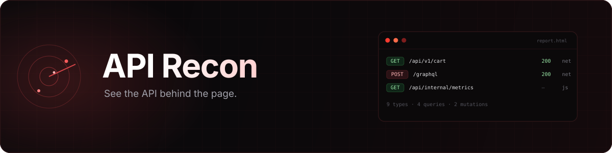
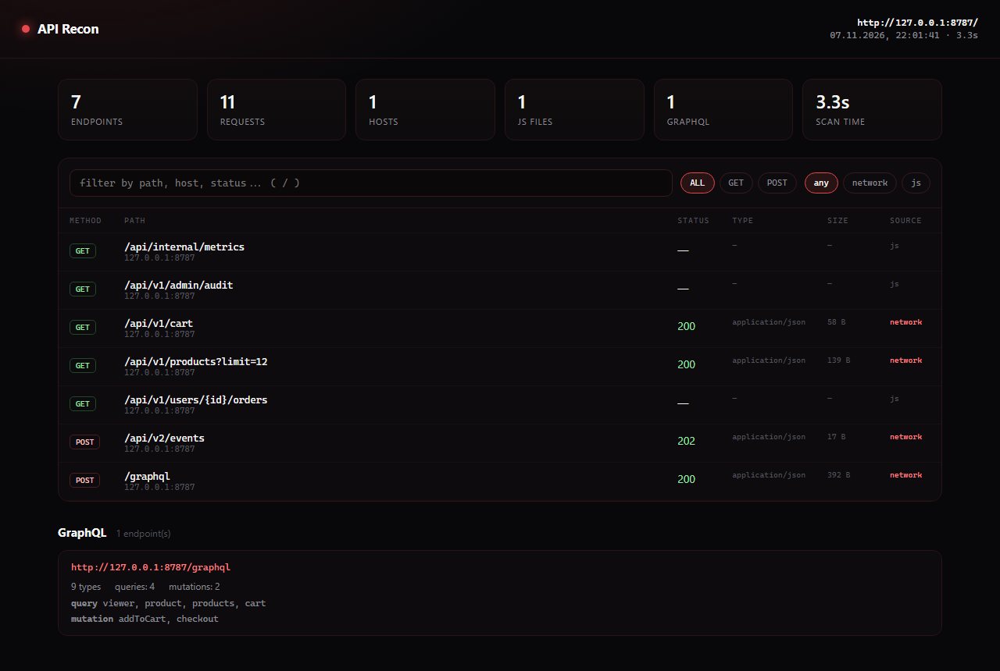

<div align="center">
  
</div>

<p align="center">
  
  <a href="https://github.com/lMezurul/apirecon/actions/workflows/ci.yml"></a>
  
  
</p>

**apirecon opens a page in Chrome, records everything it talks to, mines the JavaScript for endpoints
that never fired, introspects GraphQL, and writes one self-contained HTML report.**

No SaaS, no uploads, no accounts. The report is a single file you can open offline or attach to a
bug-bounty submission.



## What it finds

- **Live traffic** — every `XHR`/`fetch` request with method, path, status, content type and size.
- **Hidden endpoints** — paths embedded in JavaScript bundles that the UI never calls on the page
  you scanned (`/api/internal/metrics`, `/api/v1/admin/audit`, …).
- **GraphQL** — detects GraphQL endpoints, runs introspection with the page's own cookies and lists
  queries, mutations and type counts.
- **A report you can read** — filter by method, source or text, expand any row for the full URL and a
  ready-to-copy `cURL` command.

## Quick start

Requires Node.js 18+ and an installed Chrome or Edge (apirecon drives it through `puppeteer-core`,
so no 150 MB browser download).

```bash
git clone https://github.com/lMezurul/apirecon
cd apirecon
npm install
npm run build

node dist/cli.js https://example.com
# report: apirecon-example.com.html
```

Optional, to get the `apirecon` command:

```bash
npm link
apirecon https://example.com
```

## Usage

```text
apirecon <url> [options]

  -o, --out <file>      write the HTML report (default: apirecon-<host>.html)
      --json <file>     also write the raw scan as JSON
      --timeout <ms>    navigation timeout (default: 45000)
      --headed          show the browser window
      --chrome <path>   Chrome/Edge executable
      --no-graphql      skip GraphQL introspection
  -h, --help            show this help
  -v, --version         print the version
```

Console output:

```text
scanning https://example.com ...
endpoints : 7
requests  : 11
hosts     : 1
js files  : 1
graphql   : 1
time      : 3.3s

report    : apirecon-example.com.html
json      : scan.json
```

## How it works

1. Launches Chrome headless via `puppeteer-core` (system browser, no bundled Chromium).
2. Navigates, waits for network idle and scrolls the page to trigger lazy requests.
3. Collects `XHR`/`fetch` responses and same-origin script bundles, then greps the bundles for
   API-looking paths.
4. Sends a GraphQL introspection query to any endpoint that looks like GraphQL — through the page,
   so existing cookies and headers are used.
5. Renders an offline HTML report with all the data embedded.

## Demo

The repository ships a tiny mock shop with a hidden API and a GraphQL endpoint:

```bash
node demo/server.mjs            # http://127.0.0.1:8787
node dist/cli.js http://127.0.0.1:8787 --out demo/report.html
```

## Ethics and scope

- Scan only applications **you own or have written permission to test**.
- apirecon does not bypass authentication, brute-force paths, or exploit anything. It observes what
  your browser already does and asks GraphQL about its own schema.
- Keep the request rate low, respect `robots.txt` and the target's terms.
- Reports may contain tokens from request bodies — treat them as secrets.

## Limitations

- One page per run (no multi-page crawl yet); SPA route changes are not followed.
- No click-through flows: buttons that load extra data are not pressed.
- Authenticated areas need a session; use `--headed` to log in manually (planned: `--profile`).
- GraphQL introspection is often disabled in production; the report then simply lists the endpoint.

## Roadmap

- [ ] `--profile <dir>` to reuse a logged-in Chrome profile
- [ ] OpenAPI export
- [ ] HAR import/export
- [ ] multi-page crawl and `--click "selector"`
- [ ] diff two scans

## License

[MIT](LICENSE). Uses [puppeteer-core](https://github.com/puppeteer/puppeteer) (Apache-2.0).
